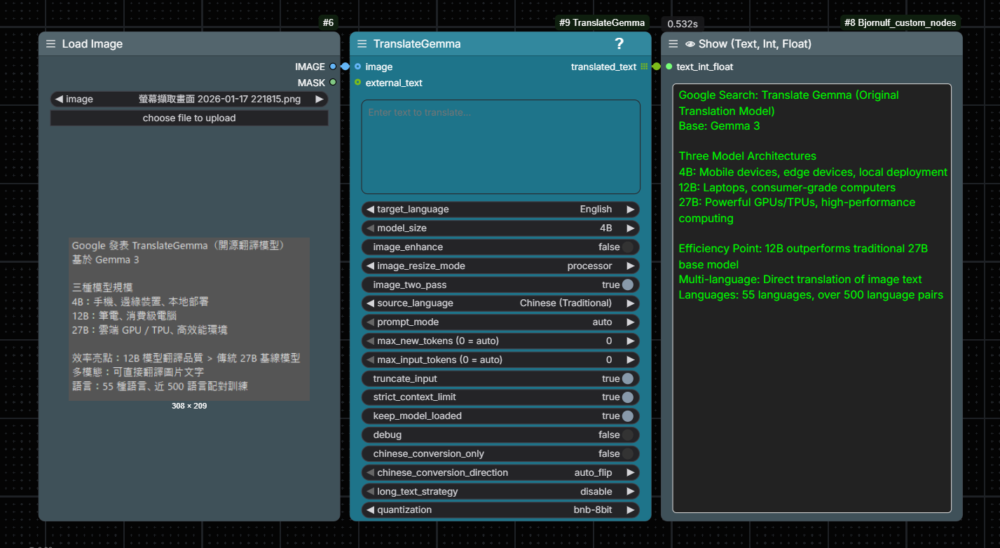

# ComfyUI-TranslateGemma

A ComfyUI integration for TranslateGemma — Google's open source translation model family built on Gemma 3. It supports 55 languages, multimodal image-to-text translation, and 4B / 12B / 27B model variants for different hardware budgets.

<p align="center">
  
</p>

[TranslateGemma: A new suite of open translation models](https://blog.google/innovation-and-ai/technology/developers-tools/translategemma/)

---

<details><summary><h2>Latest Updates - Click to expand</h2></summary>

<details>

<summary><strong>Shared ComfyUI model roots supported</strong></summary>

- Honors every path registered by ComfyUI for the exact `LLM` category, in host order.
- Reuses the first complete snapshot of the requested model without copying it into the local instance.
- Uses only the first registered/default `LLM` root for automatic download or resume when no complete snapshot exists.

</details>

<details>

<summary><strong>Host compatibility and runtime safety improved</strong></summary>

- Hardened remote-code and unsafe-weight opt-ins so ordinary load failures cannot silently widen trust.
- Improved ComfyUI device-helper compatibility and serialized shared model load/inference/unload ownership.
- Verified Python 3.12/3.13 across Transformers 4.57 and 5.x compatibility lanes.

</details>

<details>

<summary><strong>Classic, Vue Nodes, and workflow behavior aligned</strong></summary>

- Added host-backed Classic and Vue Nodes checks for native ComfyUI Node Help, labels, and frontend safety.
- Restored all established controls to default visibility after the advanced-input presentation made parameters appear missing in Classic Nodes.
- Preserved legacy positional workflow values and added named-value compatibility for newer frontend save/restore paths.

</details>

<details>

<summary><strong>Packaging and optional quantization guidance refreshed</strong></summary>

- Synchronized runtime/package version metadata and added verified Python version bounds.
- Added reproducible package-content checks so runtime assets ship without internal development records.
- Updated BitsAndBytes guidance to use the official optional install path while keeping the base install independent.

</details>

</details>

---

## Table of Contents

- [Features](#features)
- [Installation](#installation)
- [Hugging Face Access (Gated Models)](#hugging-face-access-gated-models)
- [Download Troubleshooting (Hugging Face)](#download-troubleshooting-hugging-face)
- [Model Storage Location](#model-storage-location)
  - [Manual / Offline Download (Recommended for Restricted Networks)](#manual--offline-download-recommended-for-restricted-networks)
- [Node: TranslateGemma](#node-translategemma)
  - [Input Visibility](#input-visibility)
  - [Inputs](#inputs)
  - [Outputs](#outputs)
- [Example Workflows](#example-workflows)
- [Usage Notes](#usage-notes)
  - [Text: Auto Detect](#text-auto-detect)
  - [Image Translation Requires Source Language](#image-translation-requires-source-language)
  - [Image Preprocessing (896×896)](#image-preprocessing-896896)
  - [Notes on Chinese Variants](#notes-on-chinese-variants)
  - [Chinese Conversion-Only Mode](#chinese-conversion-only-mode)
  - [Long Text Strategy](#long-text-strategy)
  - [Language Code Normalization](#language-code-normalization)
- [Default Settings](#default-settings)
- [Performance Tips](#performance-tips)
- [VRAM Notes (Native Models)](#vram-notes-native-models)
- [Quantization (bitsandbytes)](#quantization-bitsandbytes)
- [Security / Reproducibility Notes](#security--reproducibility-notes)
- [License](#license)

## Features

- Text translation across 55 languages
- Model size selection: 4B / 12B / 27B
- First-run auto download via Hugging Face (requires accepting Gemma terms)
- Flexible inputs: built-in text box + external string input
- Optional image input: translate text found in images (multimodal)
- Host-aligned device override: `default`, `cpu`, or `gpu:N` when available
- Optional BitsAndBytes quantization as a separate install path
- Chinese conversion-only mode: Simplified↔Traditional conversion via OpenCC without loading the model
- Native Node Help through ComfyUI's Node Library in both Classic and Vue Nodes
- All established controls visible by default in Classic and Vue Nodes
- Importable workflow templates with legacy positional and newer named-value compatibility

## Installation

Supported runtime:

- Python `>=3.12,<3.14` (Python 3.12 or 3.13)
- Transformers `>=4.57.0`
- The PyTorch build supplied and managed by the active ComfyUI installation

### Option A: ComfyUI-Manager

1) Open ComfyUI-Manager.
2) Search for `TranslateGemma`.
3) Install and restart ComfyUI.

### Option B: Manual

1) Clone into your ComfyUI `custom_nodes` directory (from your ComfyUI root):

```bash
cd custom_nodes
git clone https://github.com/rookiestar28/ComfyUI-TranslateGemma.git
```

2) Install dependencies:

```bash
cd ComfyUI-TranslateGemma
pip install -r requirements.txt
```

3) Optional, only for `quantization=bnb-8bit` / `quantization=bnb-4bit` on this project's CUDA path:

```bash
pip install -r requirements-quantization.txt
```

ComfyUI Desktop and portable ComfyUI users must run this with the Python environment used by ComfyUI, not a separate global Python. This installs `bitsandbytes>=0.49.2` and does not replace ComfyUI's PyTorch build. If the optional install or backend check fails, keep `quantization=none`.

4) Restart ComfyUI.

## Hugging Face Access (Gated Models)

TranslateGemma repos are gated under the Gemma terms.

1) Visit the model page and accept the license terms:

- `google/translategemma-4b-it`
- `google/translategemma-12b-it`
- `google/translategemma-27b-it`

1) Authenticate (recommended):

```bash
hf auth login
```

Alternatively, set one of these environment variables for the ComfyUI process:

- `HF_TOKEN`
- `HUGGINGFACE_HUB_TOKEN`

1) Restart ComfyUI after changing authentication.

## Download Troubleshooting (Hugging Face)

If the model download stalls at `Fetching ...` or fails with connection errors, it is usually not a node bug.
Common causes: unstable network, corporate firewall/proxy, DNS issues, or regions where `huggingface.co` is blocked
(some China networks).

Things to try:

- Retry: downloads are resumable; restarting ComfyUI often continues where it left off.
- Proxy: set `HTTP_PROXY` / `HTTPS_PROXY` for the ComfyUI process.
- Mirror endpoint (community): set `HF_ENDPOINT` (or `HUGGINGFACE_HUB_ENDPOINT`) to a mirror URL, then restart ComfyUI.
- Offline/manual: download the model on a machine that can reach Hugging Face, then copy the downloaded folder into the
  model cache directory (see **Model Storage Location** below) and restart ComfyUI.

Notes:

- Community mirrors are not official; availability and correctness are not guaranteed.
- If you see `401/403/gated/forbidden`, you likely need to accept the license and/or set `HF_TOKEN`.

## Model Storage Location

Models use a per-repo folder under a ComfyUI `LLM` model root:

- Preferred: `ComfyUI/models/LLM/TranslateGemma/<repo_name>/`
- Fallback (legacy): `ComfyUI/models/translate_gemma/<repo_name>/`
- Registered/shared root: `<registered LLM root>/TranslateGemma/<repo_name>/`

- `ComfyUI/models/LLM/TranslateGemma/translategemma-4b-it/`
- `ComfyUI/models/LLM/TranslateGemma/translategemma-12b-it/`
- `ComfyUI/models/LLM/TranslateGemma/translategemma-27b-it/`

The node checks every path registered by ComfyUI for the exact `LLM` category in host order, then
the built-in instance path and the legacy path. It reuses the first complete snapshot of the exact
requested model. A model of another size or a partial snapshot does not stop the search, and files
from different roots are never combined into one snapshot.

If no complete snapshot exists, automatic download/resume uses the first registered `LLM` root. If
the host has no registered `LLM` category, the existing preferred/legacy destination rule shown
above applies. Mark the intended writable root as `is_default` in ComfyUI's extra model path
configuration so the host places it first, for example:

```yaml
shared_models:
  base_path: ../shared-models
  is_default: true
  LLM: LLM
```

Relative `base_path` values are resolved from the extra-model-path YAML file, so this example uses
`../shared-models/LLM/TranslateGemma/<repo_name>/`. An absolute path is also supported by ComfyUI.
Category names are case-sensitive; use `LLM`. Restart ComfyUI after changing its path configuration.
If the first registered root is read-only, complete snapshots there can still be reused, but a
missing/incomplete model cannot be downloaded or resumed there. The node will not silently write
to another disk; choose a writable default root instead.

### Manual / Offline Download (Recommended for Restricted Networks)

Yes — you can manually download the model files and place them into the folders above.
This is useful if auto-download is slow/unreliable due to network restrictions (e.g. firewall/proxy, unstable DNS, or
regions where `huggingface.co` is blocked).

**What to do:**

1) On a machine that can access Hugging Face, download the **entire** model repo snapshot (all files). Keep each snapshot together under one model root; the node does not combine files across roots.
2) Copy the downloaded folder into your instance or registered/shared `LLM` path, for example:

```
ComfyUI/
  models/
    LLM/
      TranslateGemma/
        translategemma-4b-it/
          config.json
          generation_config.json
          model.safetensors.index.json
          *.safetensors
          pytorch_model*.bin (only with the explicit unsafe-weight opt-in)
          tokenizer_config.json
          special_tokens_map.json
          processor_config.json
          preprocessor_config.json
          chat_template.jinja (if present)
          ... (other files from the repo)
```

3) Restart ComfyUI. The node will load from disk and skip downloading if the snapshot is complete.

Notes:
- Gated models still require accepting the Gemma/TranslateGemma terms on Hugging Face (do this on the download machine).
- An incomplete snapshot is not reused. Automatic recovery targets the first registered/default root; it resumes that folder only when the incomplete copy is already at that destination.
- Pickle-backed `.bin` weights remain blocked unless `TRANSLATEGEMMA_ALLOW_UNSAFE_WEIGHTS=1` is explicitly set for a reviewed, pinned source. Prefer safetensors.

## Node: TranslateGemma

Category: `text/translation`

### Input Visibility

All established controls are visible when the node is created in Classic or Vue Nodes. The `image` and `external_text` link sockets remain available, and existing positional and named workflow values continue to load without migration.

### Inputs

| Name | Type | Description |
|------|------|-------------|
| `text` | STRING | Built-in text input (multiline). Ignored when `external_text` is connected. Empty/whitespace returns empty output. |
| `external_text` | STRING | When connected, **overrides** `text` (even if empty). Intended for chaining from other nodes. |
| `image` | IMAGE | If connected, uses multimodal path to translate text from the image. Requires explicit `source_language` (Auto Detect is not supported for images). |
| `image_enhance` | BOOLEAN | Mild contrast/sharpening to help small text visibility; may introduce artifacts (default: `false`). |
| `image_resize_mode` | COMBO | `letterbox` (preserve aspect ratio, recommended) / `processor` (official resize, may stretch) / `stretch` (force 896×896, may distort). Default: `letterbox`. |
| `image_two_pass` | BOOLEAN | Extract text from image first, then translate extracted text (more accurate, slower). Default: `true`. |
| `target_language` | COMBO | Translation target language. Does not affect `chinese_conversion_only=true`. |
| `source_language` | COMBO | Auto Detect is supported for text only. Images require explicit source language. Default: Auto Detect. |
| `model_size` | COMBO | 4B (fastest) / 12B / 27B trade-off (speed vs quality vs VRAM). Gated repos require HF authentication. See VRAM Notes below for rough estimates. |
| `device` | COMBO | Device override. `default` uses ComfyUI's active device; `cpu` forces CPU; `gpu:N` selects the Nth host GPU option when available. Invalid saved values fall back to `default`. |
| `prompt_mode` | COMBO | `auto` (structured first, fallback to plain) / `structured` (fail if unavailable) / `plain` (instruction only). Default: `auto`. |
| `max_new_tokens` | INT | Maximum output tokens. `0` = Auto (based on input length and remaining context budget). Also clamped by the model context window. Default: 512. |
| `max_input_tokens` | INT | Input truncation limit. `0` = Auto (reserve room for output within context). Too low can break multimodal inputs/templates. Default: 2048. |
| `truncate_input` | BOOLEAN | Truncate input if it exceeds `max_input_tokens`. Disable may cause OOM. Default: `true`. |
| `strict_context_limit` | BOOLEAN | Clamp output so input+output stays within model context window. Default: `true`. |
| `keep_model_loaded` | BOOLEAN | Keep model in memory for faster repeated use; may keep VRAM allocated. Default: `true`. |
| `debug` | BOOLEAN | Enable debug logging. Sensitive data is redacted by default. `TRANSLATEGEMMA_VERBOSE_DEBUG=1` enables local troubleshooting details that may include text or full paths. Default: `false`. |
| `chinese_conversion_only` | BOOLEAN | OpenCC conversion only (Simplified↔Traditional) without loading the model. Text-only; image not supported. Default: `false`. |
| `chinese_conversion_direction` | COMBO | `auto_flip` (detect and flip variant) / `to_traditional` (force s→t) / `to_simplified` (force t→s). Default: `auto_flip`. |
| `long_text_strategy` | COMBO | `disable` (default single-call) / `auto-continue` (continue if model stops early) / `segmented` (paragraph-by-paragraph). Default: `disable`. |
| `quantization` | COMBO | Best-effort VRAM reduction via bitsandbytes. `none` (default) / `bnb-8bit` (~50% VRAM reduction) / `bnb-4bit` (~75% VRAM reduction). `none` does not require bitsandbytes; BnB modes require CUDA + optional bitsandbytes install. |

### Outputs

| Name | Type | Description |
|------|------|-------------|
| `translated_text` | STRING | Translated text |

## Example Workflows

ComfyUI can expose the JSON files in [`example_workflows/`](example_workflows/) through its workflow template browser, or you can import them manually:

- [`basic_text_translation.json`](example_workflows/basic_text_translation.json): simple text translation.
- [`external_text_override_template.json`](example_workflows/external_text_override_template.json): template for connecting an upstream `STRING` to `external_text`.
- [`chinese_conversion_only.json`](example_workflows/chinese_conversion_only.json): OpenCC Simplified/Traditional conversion without model loading.
- [`image_translation_explicit_source.json`](example_workflows/image_translation_explicit_source.json): image translation template; connect an `IMAGE` input and keep `source_language` explicit.
- [`long_text_segmented.json`](example_workflows/long_text_segmented.json): paragraph-by-paragraph long text translation.

The shipped templates retain positional widget values for older frontends and include equivalent named values for newer save/restore paths. They do not require a workflow migration.

## Usage Notes

### Text: Auto Detect

TranslateGemma's official chat template requires an explicit `source_lang_code`.
When `source_language=Auto Detect`, this node performs a best-effort local detection for text inputs.
If you see wrong-language behavior, pick the `source_language` explicitly.

### Image Translation Requires Source Language

For images, `source_language=Auto Detect` is not supported (no OCR pre-pass). Select the correct `source_language`.

### Image Preprocessing (896×896)

For image translation, the node supports multiple preprocessing modes via `image_resize_mode`:

- `letterbox` (default): preserve aspect ratio (no stretching) by padding, then resize
- `processor`: rely on the official Gemma3 image processor resize to **896×896** (may stretch)
- `stretch`: force resize to **896×896** (may distort)

If small text is missed, try enabling `image_enhance=true` to apply mild pixel-only enhancement.

**Enhancement tuning (experimental)**:

- `TRANSLATEGEMMA_IMAGE_ENHANCE_MODE`: `gentle` (default) or `legacy`
- `TRANSLATEGEMMA_IMAGE_ENHANCE_CONTRAST`: contrast factor (default `1.10`)
- `TRANSLATEGEMMA_IMAGE_ENHANCE_SHARPNESS`: sharpness factor (default `1.10`)
- `TRANSLATEGEMMA_AUTO_MAX_NEW_TOKENS_MAX`: optional hard cap for `max_new_tokens=0` (Auto) to limit long-form outputs. If unset, Auto is only limited by context budget + other safeguards.

When `debug=true`, the node prints a redacted filename for the preprocessed temporary PNG and keeps it for inspection. Set `TRANSLATEGEMMA_VERBOSE_DEBUG=1` only when an exact path is required for local troubleshooting.

Additionally, when `debug=true`, the node saves intermediate images under `debug/`:
- `resize_mode` + `enhance_mode` prefixed files
- both the resize-only and enhance-applied variants (when enabled)

Note: For image translation, `max_input_tokens` values that are too small can truncate the model’s visual tokens and cause unrelated outputs. The node enforces a safe minimum when truncation is enabled.

### Notes on Chinese Variants

For better Traditional Chinese output consistency, the node maps:

- Chinese (Simplified) -> `zh`
- Chinese (Traditional) -> `zh-Hant`

When `source_language=Auto Detect`, the node will try to distinguish Simplified vs Traditional Chinese:

- Region hints (when available): `zh_TW/zh_HK/zh_MO` -> `zh_Hant`, `zh_CN/zh_SG/zh_MY` -> `zh`
- Character-variant heuristic: counts common simplified/traditional characters and picks `zh_Hant` only when the signal is strong

If the text is too short or ambiguous, Auto Detect may still resolve to `zh`. For guaranteed behavior, select the desired `source_language` explicitly.

Tip: If your input is Simplified Chinese but you want Traditional output, set `source_language=Auto Detect` (or `Chinese (Simplified)`) and `target_language=Chinese (Traditional)`.

If you still see mixed Simplified/Traditional output when targeting Traditional Chinese, you can enable a best-effort post-edit conversion using OpenCC:

- Install: `pip install opencc-python-reimplemented`
- Default behavior: when `target_language=Chinese (Traditional)` the node will convert Simplified → Traditional if OpenCC is available
- Disable: set `TRANSLATEGEMMA_TRADITIONAL_POSTEDIT=0`

### Chinese Conversion-Only Mode

For workflows that only need **script conversion** (Simplified ↔ Traditional) without translation, enable `chinese_conversion_only=true`. This mode:

- Uses OpenCC for fast, deterministic conversion
- **Does not load any translation model** (no GPU/VRAM required)
- Returns converted text immediately with minimal latency
- Does **not** require `target_language` to be a Chinese variant (direction is controlled separately)

**Direction selector** (`chinese_conversion_direction`):

- `auto_flip` (default): Auto-detect input variant and convert to the **opposite** script
  - Input Simplified → output Traditional
  - Input Traditional → output Simplified
  - Returns an error if input is ambiguous (ask user to force direction)
- `to_traditional`: Force Simplified → Traditional (`s2t`)
- `to_simplified`: Force Traditional → Simplified (`t2s`)

**Requirements:**

- Install OpenCC: `pip install opencc-python-reimplemented`

**Limitations:**

- Text-only: if `image` is connected, returns an error (use normal translation mode for images)
- No cross-language translation (e.g., English → Chinese still requires the model)
- `auto_flip` may fail on short/ambiguous inputs; use forced direction in those cases

**When to use:**

- You have Chinese text and only need to change the script variant
- You want to avoid model download/load overhead
- You need deterministic, reproducible output (no LLM randomness)

### Long Text Strategy

For long texts, the model may stop early (emitting `<end_of_turn>`) before completing the translation. The `long_text_strategy` option provides two approaches:

**`disable`** (default): Standard single-call behavior. Suitable for most inputs.

**`auto-continue`** (also accepts `auto_continue`): Best-effort continuation when the model stops early on long input.

- Only triggers when: input is long (≥512 tokens), model stopped via `<end_of_turn>`, and input was not truncated.
- Prompts the model to continue the translation (up to 2 additional rounds).
- Uses overlap trimming to avoid duplicated text at continuation boundaries.
- Trade-off: may increase latency (2–3× model calls), but improves completeness for long texts.

**`segmented`**: Translate paragraph-by-paragraph.

- Splits input by blank lines (preserves original separators).
- Translates each paragraph in a separate model call.
- Reassembles with original blank lines preserved.
- Trade-off: slower (N model calls for N paragraphs), but handles very long documents and preserves paragraph structure.

**When to use:**

| Scenario                                 | Recommended     |
|------------------------------------------|-----------------|
| Short/medium text (<2000 chars)          | `disable`       |
| Long text that sometimes truncates early | `auto-continue` |
| Very long document with many paragraphs  | `segmented`     |
| Speed is critical                        | `disable`       |

**Recommended settings for long documents:**

- Set `max_input_tokens=0` and `max_new_tokens=0` (Auto) so the node stays context-aware.
- If you see early stops with incomplete output: try `long_text_strategy=auto-continue`.
- For very long documents or many paragraphs: try `long_text_strategy=segmented` (more robust, but slower).

**Limitations:**

- Text-only for v1 (image path not affected).
- `segmented` mode has higher latency for many-paragraph documents.
- `auto-continue` continuation quality depends on model; may occasionally repeat or diverge.

### Language Code Normalization

The node accepts both `_` and `-` variants for language codes (e.g., `zh_Hant` and `zh-Hant`). Internally, codes are normalized to match the official TranslateGemma template format.

If an unsupported language is passed, the node prints a warning and defaults to English. Set `TRANSLATEGEMMA_STRICT_LANG=1` to raise an error instead.

## Default Settings

The following are the authoritative defaults for configurable widgets (link inputs are excluded):

| Setting | Default | Notes |
|---------|---------|-------|
| `target_language` | `English` | Translation target |
| `source_language` | `Auto Detect` | Text only; images require an explicit source language |
| `model_size` | `4B` | Smallest, fastest |
| `device` | `default` | Use ComfyUI's active device |
| `prompt_mode` | `auto` | Structured first, then plain fallback |
| `max_new_tokens` | `512` | Use `0` for auto-sizing |
| `max_input_tokens` | `2048` | Input truncation limit (`0` = Auto) |
| `keep_model_loaded` | `true` | Avoids reload overhead |
| `truncate_input` | `true` | Prevents OOM on long texts |
| `strict_context_limit` | `true` | Clamp output to the model context window |
| `debug` | `false` | Enable for diagnostics |
| `image_resize_mode` | `letterbox` | Preserves aspect ratio |
| `image_enhance` | `false` | Enables contrast/sharpening |
| `image_two_pass` | `true` | Extract then translate |
| `chinese_conversion_only` | `false` | OpenCC conversion without model |
| `chinese_conversion_direction` | `auto_flip` | Auto-detect and flip variant |
| `long_text_strategy` | `disable` | Single-call (no continuation) |
| `quantization` | `none` | No quantization (full precision) |

## Performance Tips

- Leave `keep_model_loaded=true` for repeated use (avoids reload time).
- Set `keep_model_loaded=false` when memory release after each run is more important than reload latency.
- Shared model load, inference, switch, and unload operations are serialized to prevent concurrent cache mutation; simultaneous runs may wait for the current model owner.
- A failed inference evicts the cached model so the next run cannot reuse an uncertain model state.
- Use the 4B model if you are unsure about hardware limits.
- First run is slower due to download and weight initialization.

## VRAM Notes (Native Models)

- Rough starting point (varies by GPU, dtype, drivers, and context length):
  - 4B model: ~12 GB
  - 12B model: ~27 GB
  - 27B model: ~56 GB

## Quantization (bitsandbytes)

**Best-effort VRAM reduction** for running larger models (12B/27B) on consumer GPUs.

### How It Works

The `quantization` input allows you to load the model in lower precision using [bitsandbytes](https://github.com/TimDettmers/bitsandbytes):

| Mode | VRAM Reduction | Quality | Notes |
|------|----------------|---------|-------|
| `none` (default) | — | Best | Full precision (BF16/FP16) |
| `bnb-8bit` | ~50% | Good | 8-bit quantization |
| `bnb-4bit` | ~75% | Acceptable | 4-bit NF4 quantization |

### Requirements and support boundary

- Install `bitsandbytes>=0.49.2` into the Python environment already used by ComfyUI: `python -m pip install -r requirements-quantization.txt`.
- Use the PyTorch and accelerator build supplied by ComfyUI. The optional install does not replace ComfyUI's PyTorch.
- Upstream BitsAndBytes requires Python 3.10+ and PyTorch 2.4+; this project declares its separately tested Python range in `pyproject.toml`.
- Official installation and platform tables: <https://huggingface.co/docs/bitsandbytes/installation>.

`bitsandbytes` is intentionally absent from base `requirements.txt`. Base installs and `quantization=none` do not import or require it.

Official upstream packages currently describe NVIDIA CUDA, AMD ROCm, Intel XPU, Intel HPU/Gaudi, CPU, and Apple Silicon/MPS paths. That upstream availability is not the same as project support. This release keeps TranslateGemma's BnB integration on the existing **CUDA-only, best-effort** path. ROCm, XPU, HPU, CPU, and MPS model loading remain deferred until this project has device-map, load, and inference evidence for each backend. Official Windows x86-64 wheels include CUDA 13.0 builds, but this repository's package-only check does not prove a real TranslateGemma GPU run.

### Troubleshooting

"TranslateGemma bitsandbytes mode ... only for this project's CUDA device path":

- The selected ComfyUI device is outside this project's currently verified integration path.
- Set `quantization=none` or select a CUDA device already supported by the active ComfyUI environment.

"bitsandbytes not installed":

- Install into the ComfyUI Python environment: `python -m pip install -r requirements-quantization.txt` or `python -m pip install "bitsandbytes>=0.49.2"`.
- Use only the [official BitsAndBytes installation guide](https://huggingface.co/docs/bitsandbytes/installation) and official PyPI packages.
- ComfyUI Desktop users should keep the host's PyTorch build. If installation or backend loading fails, use `quantization=none` or the 4B model.

"BitsAndBytesConfig not found":

- Reinstall this node's declared requirements in the ComfyUI Python environment; do not replace the host's PyTorch build.

"CUDA Setup failed" or "libbitsandbytes_cudaXXX not found" (import succeeds but loading fails):

- This means bitsandbytes was built for a different CUDA version or your GPU's compute capability is unsupported
- Set `quantization=none` as a workaround
- Report the fixed user-facing message and package versions; redact local paths, environment values, tokens, and native-loader details.

### Environment Variables (Advanced)

- `TRANSLATEGEMMA_BNB_4BIT_COMPUTE_DTYPE`: Force compute dtype for 4-bit (`bf16` or `fp16`). Default: auto-detect.
- `TRANSLATEGEMMA_BNB_4BIT_DOUBLE_QUANT`: Enable double quantization (`1` = enabled, `0` = disabled). Default: `1`.

### Limitations

- Quantization is **best-effort**: TranslateGemma official docs do not explicitly promise bitsandbytes support
- Translation quality may degrade slightly with quantization
- Project support is deliberately narrower than upstream: only the CUDA path is currently enabled, and it remains best-effort without a real gated-model GPU acceptance lane.
- ROCm, XPU, HPU, CPU, and MPS/Apple integration is deferred rather than implied by upstream wheel availability.

## Security / Reproducibility Notes

### Remote Code Policy

- The loader always starts with `trust_remote_code=False` and retries only when Transformers explicitly reports that repository custom code is required.
- Remote code is denied by default. Set `TRANSLATEGEMMA_ALLOW_REMOTE_CODE=1` only after reviewing the repository code.
- Optionally set `TRANSLATEGEMMA_REMOTE_CODE_ALLOWLIST=google/translategemma-4b-it,google/translategemma-12b-it` to require an exact repository match in addition to the explicit opt-in.
- Authentication, network, disk, dependency, safetensors, and generic model-loading errors never authorize remote code.

### Weight Format Policy

- Safetensors are required by default. Remote-code permission does not permit pickle-backed model weights.
- If a reviewed model is available only in a non-safetensors format, set `TRANSLATEGEMMA_ALLOW_UNSAFE_WEIGHTS=1` as a separate explicit opt-in.
- Non-safetensors weights can execute code while being deserialized. Enable this option only for a trusted, pinned model source.

### Revision Pinning

- Pin a specific commit revision for reproducibility via `TRANSLATEGEMMA_REVISION=<commit-hash>`, especially whenever remote code or non-safetensors weights are enabled.

### Debug Privacy

- By default, `debug=true` redacts sensitive data (user text content, full filesystem paths).
- `TRANSLATEGEMMA_VERBOSE_DEBUG=1` may expose user text and full filesystem paths in console logs. Enable it only for temporary local troubleshooting, and sanitize logs before sharing them.

### Download Recovery

- If a download is interrupted, the loader auto-resumes on next run.
- If corruption persists, stop ComfyUI, verify the exact selected root, and back up or remove only the affected `<repo_name>` folder before retrying. Shared roots may be outside the ComfyUI directory; do not delete the entire `LLM` or `TranslateGemma` tree.

## License

This repository is licensed under the MIT License (see `LICENSE`). TranslateGemma model weights are governed by Google's Gemma Terms of Use.
